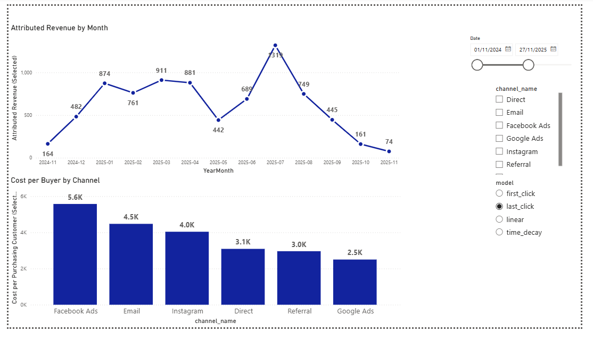

# Marketing Attribution & Cohort LTV
**MySQL · Python · Power BI**

A reproducible analytics pipeline and three-page Power BI report for comparing first-click, last-click, linear and time-decay attribution. The model conserves order revenue to the cent and measures observed cohort revenue at fully observed horizons.

## Report

Open [Dashboard_P1.pbix](powerbi/Dashboard_P1.pbix) in Power BI Desktop. The report contains the corrected imported sample; a local MySQL connection is needed to refresh it, rather than to view its existing data.

- **Page 1:** attributed revenue, orders, spend, cost per buyer, ROAS and cohort LTV.
- **Page 2:** channel-attributed revenue and ROAS.
- **Page 3:** chronological monthly revenue and cost per buyer by channel.



The screenshot shows the refreshed Desktop report, using all channels and last-click attribution. November 2024 and November 2025 are separate months.

## Metric definitions

| Metric | Definition and scope |
|---|---|
| Attributed Revenue (Selected) | The selected model's share of order revenue for the selected channels and order dates. |
| Total Revenue (Selected) | Alias of attributed revenue, so the overview card and channel charts use the same allocation. |
| Orders (Selected) | Distinct orders with credit assigned to the selected channels/model within the order-date range. Channel counts can overlap under split-credit models. |
| Customers (Selected) | Distinct buyers on those orders, including repeat buyers. These counts are not additive across channels. |
| Total Spend (Selected) | Spend for the selected channels and calendar dates. |
| Cost per Buyer | Selected spend divided by those distinct purchasing customers. It is a period buyer-cost metric, not acquisition-cohort CAC. |
| Cohort LTV | Mean observed revenue per eligible signed-up customer at 30/60/90/180 days, including customers with zero purchases. Only customers with the complete observation window are included. |
| ROAS | Attributed revenue divided by spend; a ratio, not a percentage. |

Select exactly one attribution model. For cohort LTV, no horizon selection defaults to 180 days; selecting multiple horizons returns a blank card. Channel, order-date and model selectors do not filter the LTV visuals. The LTV line retains all four horizons.

Eligibility changes by horizon, so the LTV line does not necessarily compare identical customer populations. Cohort LTV and period buyer cost are shown separately because their populations and time windows differ.

All source data is synthetic. Amounts use one shared demo monetary unit; the source files do not specify an ISO currency. The report's dollar sign is a display convention, and no foreign-exchange conversion is applied. Treat the data as a metric demonstration, not business evidence for a budget decision.

## Validated sample

| Check | Value |
|---|---:|
| Customers | 80 |
| Orders | 108 |
| Order revenue / each model's total attributed revenue | 7,951.11 |
| Attribution rows | 1,310 |
| Eligible customer/horizon LTV rows | 303 |
| LTV rows with zero revenue | 113 |

| Horizon | Eligible customers | Mean observed revenue |
|---|---:|---:|
| 30 days | 80 | 26.16025 |
| 60 days | 80 | 63.48175 |
| 90 days | 80 | 83.042875 |
| 180 days | 63 | 96.125556 |

The report's initial date range is 2024-11-01 through 2025-11-27. Google Ads attributed revenue is 1,171.85 under linear attribution and 1,137.10 under time decay, rather than the full value of every shared order.

## Run the pipeline

Use Python 3.12 and MySQL 8.0.42. From the repository root:

```powershell
python -m venv .venv
.\.venv\Scripts\Activate.ps1
pip install -r requirements.txt
```

Copy `.env.example` to `.env`, supply your own MySQL credentials, and set `MYSQL_DB=analytics_portfolio_corrected` to match the committed report. The pipeline user needs database/table creation permissions. Do not commit the real `.env`.

```powershell
python -m scripts.run_pipeline
```

The pipeline loads the bundled CSVs, preserves order/customer identities, builds the four attribution models and computes eligible cohort LTV. Unassigned orders use the explicit **Unattributed** channel. Revenue is allocated in whole cents.

`ANALYTICS_AS_OF_DATE` sets the actual observation end; otherwise it is inferred conservatively from source observations. Do not move this date forward merely to make a cohort mature.

### Refresh Power BI

The eight Power Query queries connect to `localhost / analytics_portfolio_corrected`, with `ReturnSingleDatabase=true` and `CreateNavigationProperties=false`. Enter database credentials locally through Power BI's data-source settings.

For another host or database, update the connection and navigation schema in each query. Preserve the query/table names so existing measures and visuals remain valid. The report uses `Calendar[YearMonth]` in ascending order, rather than month names without years.

### Import without a local Python environment

The [metrics workflow](https://github.com/rirts/marketing-attribution-ltv-platform/actions/workflows/ci.yml) publishes a `marketing-corrected-mysql-snapshot` artifact containing `marketing_corregido.sql` and validation manifests. Run the workflow or use a successful recent run.

The SQL creates a fresh **analytics_portfolio_corrected** database and imports the eight corrected tables. It preserves the original **analytics_portfolio** database. Import once into a fresh destination; diagnose any partial import before trying again.

CI restores the SQL, compares every source table by ordered row hash, reruns metric invariants and verifies that the original database is unchanged. Artifacts are retained for 30 days.

## Validation

```powershell
pip install -r requirements-dev.txt
python -m pytest -q
python -m scripts.verify_metrics
python -m scripts.verify_powerbi
```

The last command compares every imported source value in the committed PBIX with the configured MySQL database, checks the Power Query connections, the corrected revenue-card alias, removal of the LTV/CAC measure, model selectors and the monthly axis. It allows 2 ms of date readback tolerance for VertiPaq decoding.

CI rebuilds twice against MySQL 8.0.42, checks attribution and purchase identity, validates the committed PBIX, and exports/restores the SQL snapshot. If source data changes, update and refresh the PBIX too; stale imported data should fail this check.

Readback and definition checks do **not** execute DAX or render visuals. Desktop refresh and interaction checks were completed separately; see [Power BI validation](powerbi/VALIDATION.md). [metric_fixes.dax](powerbi/metric_fixes.dax) records the applied measure definitions, and [regression_checks.dax](powerbi/regression_checks.dax) contains queries for Desktop validation.

## Structure

- `data/raw/`: synthetic source CSVs.
- `scripts/`: ingestion, attribution, cohort LTV and validation.
- `common/`: shared database connection.
- `sql/`: schema.
- `powerbi/`: report, applied DAX, validation notes and a current Desktop screenshot.

The compact PBIX is stored directly in Git as a binary file; Git LFS is not required.

